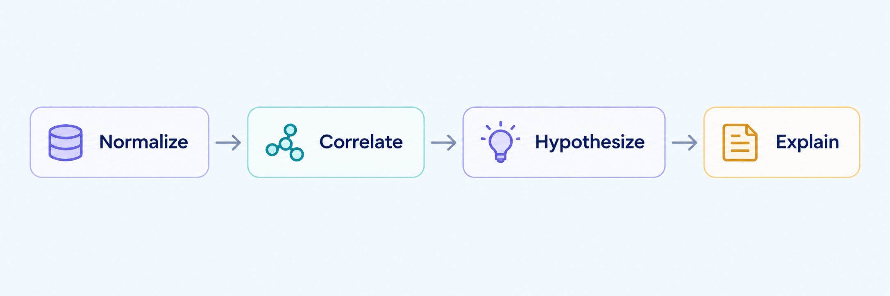

# ForensicAI

Evidence-grounded cybersecurity root-cause analysis for CAM-LDS telemetry.



ForensicAI turns defender-visible logs into a short, evidence-linked incident explanation. It never treats attacker-side labels as telemetry.

## Pipeline

1. `rca_engine.py` parses defender-visible logs into normalized events.
2. `correlation_engine.py` builds a compact event/entity graph.
3. `hypothesis_engine.py` ranks deterministic, evidence-linked hypotheses.
4. `agentic_hypothesis_agent.py` optionally refines hypotheses with Groq.

Attacker-side logs are excluded by the parser. They are evaluation labels, not defender evidence.

## Usage

```powershell
python rca_engine.py path/to/scenario
python correlation_engine.py path/to/output
python hypothesis_engine.py path/to/output

$env:GROQ_API_KEY = "your-key"
python agentic_hypothesis_agent.py path/to/output
```

The generated files are:

- `normalized_events.jsonl` — one common event format with timestamps and provenance.
- `investigation_graph.json` — compact event/entity relationships.
- `hypotheses.json` — deterministic, ranked hypotheses with supporting event IDs.
- `agentic_hypotheses.json` — optional LLM refinement and chronological story.
- `attack_story.txt` — readable incident narrative when the agent runs.

Run the stages in order. The LLM stage is optional; the first three stages work without an API key.

The API key is read only from `GROQ_API_KEY`; never put it in source code or committed files.

Use `python correlation_engine.py path/to/output --full` only when a detailed graph with edge explanations is required.
